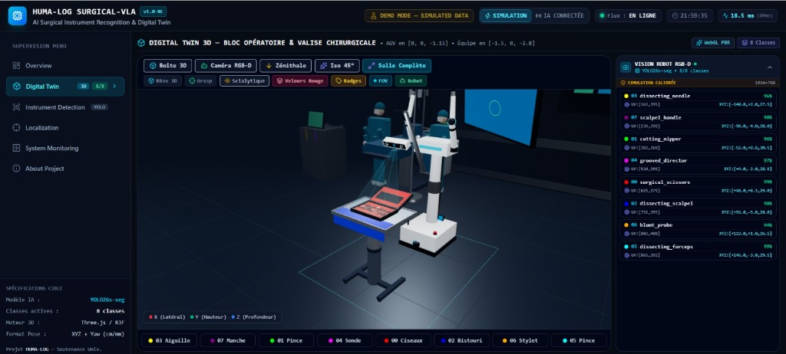
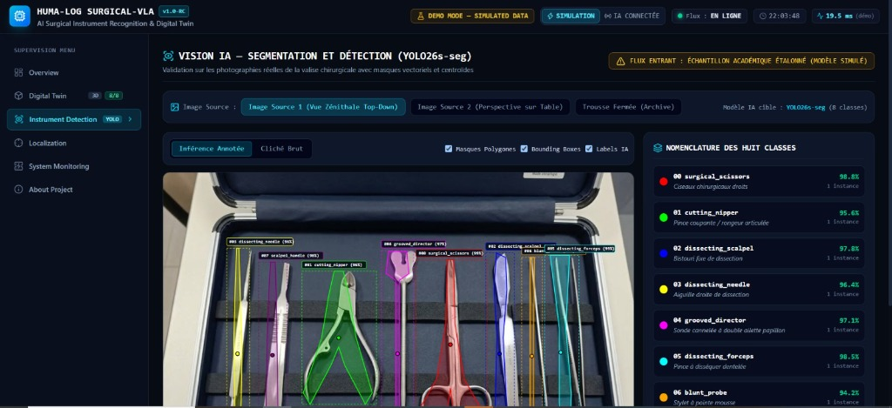
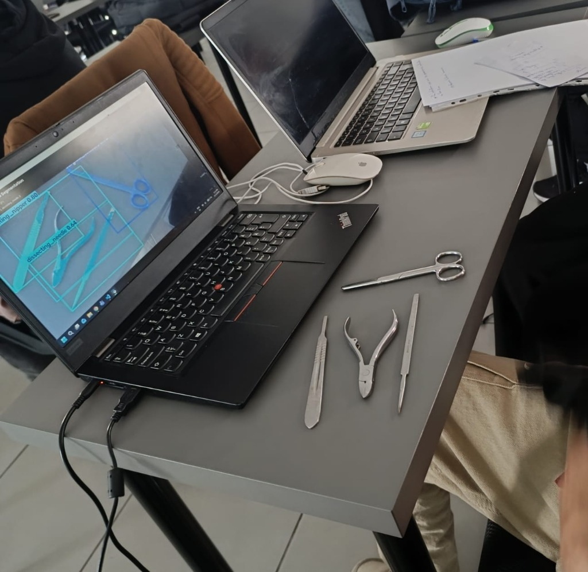
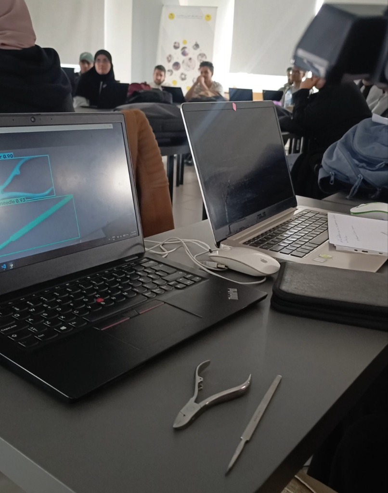
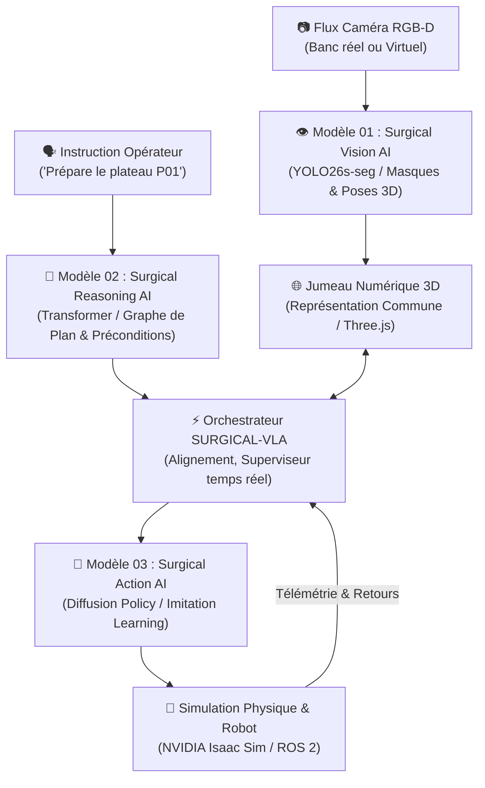

# HUMA-LOG SURGICAL-VLA
### 🏥 AI Surgical Instrument Recognition, 3D Digital Twin & VLA Robotics Platform

[](https://react.dev/)
[](https://threejs.org/)
[](https://vitejs.dev/)
[](https://www.typescriptlang.org/)
[](https://www.python.org/)
[](https://fastapi.tiangolo.com/)
[](https://ultralytics.com/)
[](https://www.ros.org/)

---

## 📌 Table of Contents / Sommaire
- [🎯 Vision & Objectif Global du Projet](#-vision--objectif-global-du-projet)
- [📸 Galerie du Projet (Jumeau 3D & Validation Réelle en Laboratoire)](#-galerie-du-projet)
- [✨ Fonctionnalités Majeures du Jumeau Numérique 3D](#-fonctionnalités-majeures-du-jumeau-numérique-3d)
- [🧠 Architecture VLA à Trois Modèles d'IA](#-architecture-vla-à-trois-modèles-dia)
- [🏷️ Nomenclature des 8 Classes d'Instruments Chirurgicaux](#-nomenclature-des-8-classes-dinstruments-chirurgicaux)
- [🗺️ Scénario Opérationnel à 3 Zones (A, B, C)](#-scénario-opérationnel-à-3-zones-a-b-c)
- [💻 Stack Technologique](#-stack-technologique)
- [⚡ Installation & Démarrage Rapide](#-installation--démarrage-rapide)
- [📁 Structure du Projet](#-structure-du-projet)
- [⌨️ Raccourcis Clavier](#️-raccourcis-clavier)
- [📚 Documentation Complète & Références](#-documentation-complète--références)
- [👤 Auteur & Profil](#-auteur--profil)

---

## 🎯 Vision & Objectif Global du Projet

### 🇲🇦 / 🇫🇷 Contexte & Problématique Clinique
Dans un bloc opératoire stérile, la préparation manuelle, le décompte et la traçabilité des kits chirurgicaux représentent des enjeux critiques pour la **sécurité du patient** et la fluidité des interventions. L'oubli d'un instrument (*Retained Foreign Object - RFO*) ou une confusion d'outils entraîne des complications opératoires sévères et des retards organisationnels majeurs.

### 🎯 L'Objectif de **HUMA-LOG SURGICAL-VLA**
Le projet **HUMA-LOG SURGICAL-VLA** a pour objectif de concevoir et valider une architecture d'**Intelligence Artificielle Physique (Physical AI)** unifiée de type **Vision–Language–Action (VLA)** couplée à un **Jumeau Numérique 3D photoréaliste temps réel (Three.js / WebGL)**.

Le système articule une plateforme mobile d'inspection (robot AGV équipé d'un mât de perception stéréoscopique RGB-D) capable de :
1. **Percevoir & Classifier :** Identifier instantanément et segmenter avec précision les instruments de chirurgie disposés dans leur valise stérile.
2. **Localiser en 3D Métrique :** Calculer les coordonnées spatiales submillimétriques $[X, Y, Z]$ dans le repère local de la boîte et les synchroniser sans latence dans le jumeau numérique.
3. **Raisonner & Planifier :** Décomposer une instruction humaine en langage naturel (ex. *« Prépare le plateau pour la simulation P01 »*) en une séquence de sous-objectifs validés sous contraintes d'asepsie.
4. **Agir en Simulation :** Préparer la manipulation robotique fine et sécurisée via simulation physique (NVIDIA Isaac Sim / Isaac Lab et passerelle ROS 2).

> [!NOTE]
> **Rôle non-invasif du robot :** Lors des phases d'inspection clinique, le robot AGV agit comme une vigie optique de contrôle qualité stérile en retrait de la table d'opération. Il ne touche pas le patient et garantit la conformité avant toute manipulation.

---

## 📸 Galerie du Projet

### 1. Supervision du Jumeau Numérique 3D (Three.js / WebGL PBR)
Vue globale interactive du bloc opératoire : Robot AGV de vision RGB-D, cône de projection optique, table chirurgicale stérile et valise d'instruments avec télémétrie en temps réel.


---

### 2. Détection & Segmentation IA d'Instruments (YOLO26s-seg)
Segmentation d'instance en temps réel sur les 8 classes officielles avec masques polygonaux, boîtes englobantes et scores de confiance supérieurs à 95%.


---

### 3. Validation Physique en Laboratoire (Banc Réel)
Test expérimental en conditions réelles avec station d'inférence ThinkPad et véritables instruments chirurgicaux de dissection posés sur table.


---

### 4. Démonstration Académique & Soutenance
Présentation en direct du système complet devant l'audience académique et le jury.


---

## ✨ Fonctionnalités Majeures du Jumeau Numérique 3D

- **Rendu Photoréaliste PBR (Physically-Based Rendering) :**
  - Châssis de valise en aluminium brossé et composite bleu nuit avec renforts d'angle chromés (*ball corners*).
  - 8 instruments procéduraux modélisés d'après les cotes anatomiques réelles en acier inoxydable chirurgical satiné AISI 316L.
  - Habillage intérieur commutable en un clic : **Mousse EVA usinée anthracite** avec rigole centrale de prise vs **Sangles élastiques textiles bleues**.
- **Performance Zéro-Jitter à 60 FPS :**
  - Dissociation stricte entre les maillages géométriques stables et les flux de métadonnées de simulation pour un confort visuel optimal sans tremblement.
- **Modes de Caméra Avancés :**
  - `Boîte 3D` : cadrage rapproché centré sur la valise ouverte.
  - `Caméra RGB-D` : perspective subjective simulée du capteur du robot AGV.
  - `Zénithale (Top-Down)` : vue orthogonale de dessus, alignée avec le flux de vision par ordinateur.
  - `Iso 45°` : perspective axonométrique technique.
  - `Salle Complète` : vue d'ensemble du bloc opératoire et du personnel soignant.
- **Inspecteur Clinique & Zoom Interactif :**
  - Clic sur n'importe quel instrument $\rightarrow$ animation de focalisation (*lerp* caméra fluide), halo lumineux de la couleur officielle YOLO, affichage des dimensions métriques ($L \times l \times e$), rôle opératoire et coordonnées $[X, Y, Z]$.
- **Annotation Studio Intégré :**
  - Outil web interactif pour charger des images réelles, tracer des polygones de segmentation et exporter directement des datasets conformes au format YOLO Segmentation.

---

## 🧠 Architecture VLA à Trois Modèles d'IA

Le projet est conçu selon une architecture modulaire unifiée **Vision–Language–Action** :



### 1. Modèle 01 — Surgical Vision AI
- **Réseau :** YOLOv8-seg / YOLO26s-seg optimisé pour l'inférence temps réel ($\le 20\text{ ms}$).
- **Mission :** Segmentation d'instance sur 8 classes chirurgicales, gestion des reflets métalliques spéculaires et estimation des centroïdes $2D \rightarrow 3D$.
- **Performances constatées :** Confiance moyenne $> 95\%$, mAP50-95 élevé sur banc de test.

### 2. Modèle 02 — Surgical Reasoning AI
- **Réseau :** Modèle de langage & planification symbolique (Transformer de planification).
- **Mission :** Traduction des missions cliniques en sous-objectifs déterministes.
- **Gestion des pannes & aléas :**
  - *Instrument manquant :* Détection de l'absence, blocage sécurisé et notification de l'opérateur.
  - *Instrument déplacé :* Recalibration dynamique et mise à jour immédiate du graphe d'action.

### 3. Modèle 03 — Surgical Action AI
- **Technologie :** Imitation Learning & Diffusion Policy / Flow Matching.
- **Cible :** Manipulation fine et transfert d'instruments sans choc en environnement simulé contraint (**NVIDIA Isaac Sim / Isaac Lab** via interfaces **ROS 2**).

### 🔁 Boucle d'Exécution Fermée
$$\text{Observer} \longrightarrow \text{Identifier} \longrightarrow \text{Planifier} \longrightarrow \text{Exécuter} \longrightarrow \text{Vérifier} \longrightarrow \text{Réévaluer}$$

---

## 🏷️ Nomenclature des 8 Classes d'Instruments Chirurgicaux

Disposition standardisée de gauche à droite dans la boîte médicale de référence :

| ID | Classe IA Technique | Nom Clinique (Français) | Couleur Hex | Position X (m) | Signes Morphologiques Distinctifs |
|:--:|:--------------------|:-------------------------|:-----------:|:--------------:|:----------------------------------|
| **3** | `dissecting_needle` | Aiguille droite de dissection | `#FFFF00` | `-0.140` | Manche hexagonal prismatique, pointe droite effilée. |
| **7** | `scalpel_handle` | Manche de bistouri n°3/4 | `#800080` | `-0.098` | Glissière baïonnette pour lame stérile, crans pour le pouce. |
| **1** | `cutting_nipper` | Pince coupante / rongeur | `#00FF00` | `-0.052` | Poignées courbes à ressort double lame, mors biseautés. |
| **4** | `grooved_director` | Sonde cannelée papillon | `#FF00FF` | `+0.004` | Tige cannelée avec **double ailette papillon échancrée**. |
| **0** | `surgical_scissors` | Ciseaux chirurgicaux droits | `#FF0000` | `+0.048` | Anneaux digitaux, vis de pivot centrale, lames droites. |
| **2** | `dissecting_scalpel` | Bistouri fixe de dissection | `#0000FF` | `+0.092` | Lame monobloc courbée fixe, manche plat nervuré. |
| **6** | `blunt_probe` | Stylet à pointe mousse | `#FFA500` | `+0.122` | Tige cylindrique droite très fine avec embouts sphériques. |
| **5** | `dissecting_forceps` | Pince à disséquer dentelée | `#00FFFF` | `+0.146` | Mors striés, zone de grip bilatérale, talon soudé élastique. |

---

## 🗺️ Scénario Opérationnel à 3 Zones (A, B, C)

```
[ ZONE A : Stockage ]          [ ZONE B : Préparation ]          [ ZONE C : Livraison ]
 Valise / Boîte fermée     ==>   Plateau Mayo Stérile       ==>   Équipe Chirurgicale
 Identification & Pick           Placement Ordonné P01            Acheminement & Check
```

1. **Zone A (Stockage) :** La valise est scannée par le capteur RGB-D. Chaque instrument requis est identifié avec sa pose 3D validée.
2. **Zone B (Préparation) :** Les instruments sélectionnés sont disposés sur le plateau stérile dans l'ordre chronologique d'utilisation opératoire.
3. **Zone C (Livraison) :** Acheminement du plateau complet vers la zone d'intervention et validation d'intégrité finale.

---

## 💻 Stack Technologique

### Frontend & Jumeau 3D
- **Framework :** React 19 + TypeScript (Strict Mode)
- **Moteur 3D :** Three.js + React Three Fiber (`@react-three/fiber`) + Drei (`@react-three/drei`)
- **Build Tool :** Vite 8
- **Styling & UI :** Tailwind CSS v4 + Lucide React Icons

### Backend & Vision IA
- **Serveur API :** FastAPI + Uvicorn (REST & WebSockets bidirectionnels)
- **Computer Vision :** Ultralytics YOLO (YOLOv8 / YOLO26-seg), OpenCV, NumPy
- **Format de Télémétrie :** JSON standardisé à 30 Hz ($\le 18.5\text{ ms}$)

### Robotique & Simulation (Roadmap)
- **Middleware Robotique :** ROS 2 (Humble / Jazzy) via `vision_msgs/Detection3DArray` & TF2
- **Simulateur Physique :** NVIDIA Isaac Sim / Isaac Lab

---

## ⚡ Installation & Démarrage Rapide

### Prérequis
- **Node.js** $\ge 18.0$ et **npm**
- **Python** $\ge 3.10$ avec environnement virtuel

### Option 1 : Lancement Automatisé en 1 Clic (Windows)
Double-cliquez simplement sur :
- `LANCER_PLATEFORME.bat` : Démarre automatiquement le backend FastAPI et le serveur Vite Frontend.
- `ARRETER_PLATEFORME.bat` : Ferme proprement tous les processus en cours.

---

### Option 2 : Lancement Manuel

#### 1. Cloner le Répertoire
```bash
git clone https://github.com/imadabail08-cpu/HUMA_LOG_SURGICAL_VLA.git
cd HUMA_LOG_SURGICAL_VLA
```

#### 2. Démarrer le Frontend (Jumeau Numérique 3D)
```bash
npm install
npm run dev
```
👉 Accédez à l'application dans votre navigateur : **http://localhost:5173/**

#### 3. Démarrer le Backend FastAPI (Module Vision & Annotation)
Dans un second terminal :
```bash
cd backend
python -m venv .venv
# Sur Windows :
.venv\Scripts\activate
# Installer les dépendances :
pip install -r requirements.txt
# Lancer le serveur :
python -m uvicorn app.main:app --host 127.0.0.1 --port 8000 --reload
```
👉 Documentation Swagger interactive : **http://127.0.0.1:8000/docs**

---

## 📁 Structure du Projet

```text
HUMA_LOG_SURGICAL_VLA/
├── docs/                           # Documentation technique & académique
│   ├── DOSSIER_TECHNIQUE_SURGICAL_VLA.md  # Dossier technique complet (13 chapitres)
│   └── images/                     # Captures d'écran & photos de validation réelle
│       ├── 01_digital_twin_3d_supervision.jpg
│       ├── 02_ai_vision_yolo_segmentation.jpg
│       ├── 03_physical_lab_validation_live.jpg
│       └── 04_academic_presentation_demo.jpg
├── public/                         # Assets publics WebGL & textures
│   ├── images/                     # Clichés réels & textures
│   └── models/                     # Modèles 3D précalculés
├── src/                            # Code source Frontend (React + Three.js)
│   ├── components/                 # Composants UI réutilisables & HUD
│   ├── pages/                      # Vues de l'application (DigitalTwin, Detection, Overview, etc.)
│   ├── scene/                      # Objets procéduraux 3D (SurgicalRoom, VisionRobotAGV, Instruments)
│   ├── services/                   # Connecteurs WebSocket & passerelle REST
│   ├── types/                      # Interfaces TypeScript (Detections, Instruments)
│   └── utils/                      # Transformations de coordonnées métriques
├── backend/                        # Backend Python FastAPI & Modèles IA
│   ├── app/                        # Endpoints API, WebSocket & contrôleurs
│   ├── models/                     # Schémas Pydantic & logique IA
│   ├── storage/                    # Datasets de démonstration & exports YOLO
│   └── requirements.txt            # Dépendances Python
├── LANCER_PLATEFORME.bat           # Script de démarrage rapide 1-clic
├── ARRETER_PLATEFORME.bat          # Script d'arrêt rapide
├── PRESENTATION_7MIN.md            # Guide oral de soutenance chronométré
└── README.md                       # Présentation principale du projet
```

---

## ⌨️ Raccourcis Clavier

| Touche | Action |
|:---:|:---|
| `1` | Naviguer vers la page **Overview** (Vue d'ensemble) |
| `2` | Naviguer vers le **Digital Twin 3D** (Jumeau Numérique) |
| `3` | Naviguer vers **Instrument Detection** (Segmentation YOLO) |
| `4` | Naviguer vers **Localization** (Cartographie métrique) |
| `5` | Naviguer vers **System Monitoring** (Télémétrie & latence) |
| `6` | Naviguer vers **About Project** (Architecture & pipeline) |
| `Espace` | Mettre en pause ou relancer le flux télémétrique |
| `Échap` | Réinitialiser la sélection et recadrer la caméra |

---

## 📚 Documentation Complète & Références

- 📄 **Dossier Technique & Scientifique Exhaustif :** [docs/DOSSIER_TECHNIQUE_SURGICAL_VLA.md](docs/DOSSIER_TECHNIQUE_SURGICAL_VLA.md)
  *(Couvre la formulation mathématique, les contrats d'interface, le protocole d'apprentissage et la validation hybride).*
- ⏱️ **Guide Oral de Soutenance (7 Minutes Chrono) :** [PRESENTATION_7MIN.md](PRESENTATION_7MIN.md)
  *(Minutage précis, scripts oratoires et réponses types aux questions du jury).*

---

## 👤 Auteur & Profil

**Imad Abail**
- 🐙 **GitHub :** [@imadabail08-hue](https://github.com/imadabail08-hue)
- 💼 **LinkedIn :** [imad-abail-765440287](https://www.linkedin.com/in/imad-abail-765440287)
- 🎓 **Email Académique :** [imad_abail@um5.ac.ma](mailto:imad_abail@um5.ac.ma)
- 🔬 **Domaine de Recherche :** Physical AI, Computer Vision, Digital Twins & Medical Robotics
- 💼 **Projet :** HUMA-LOG SURGICAL-VLA (Fin d'Études / Recherche Académique)

---
*Développé avec passion pour l'innovation en robotique médicale et en vision artificielle.*
