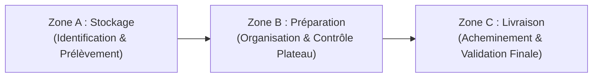
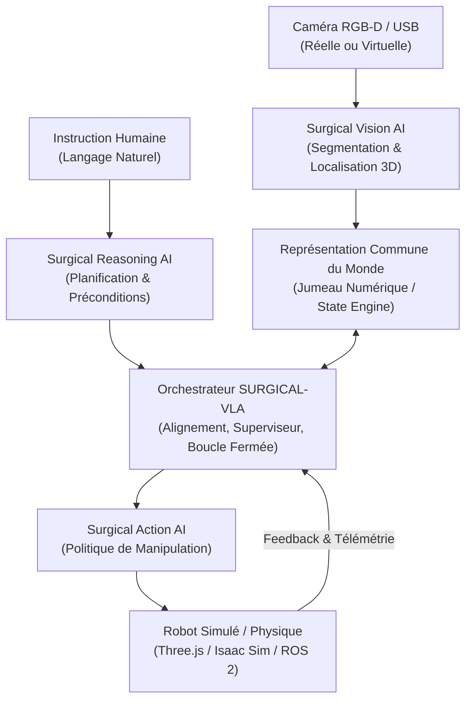
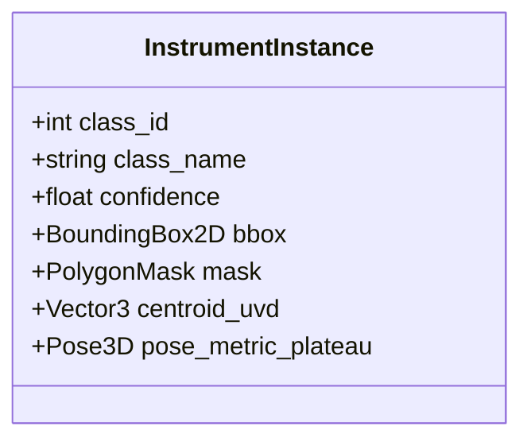
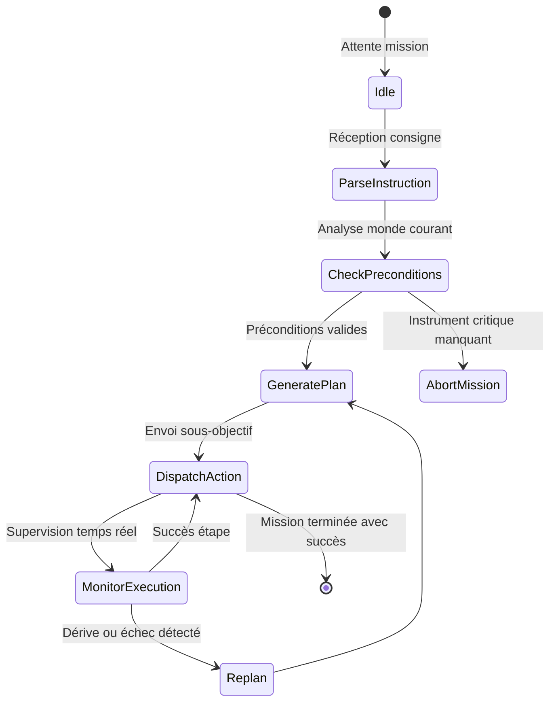
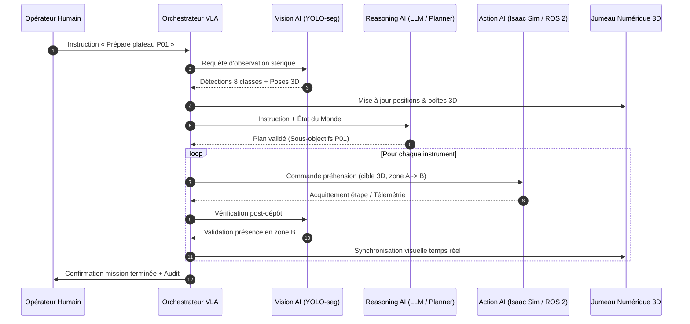
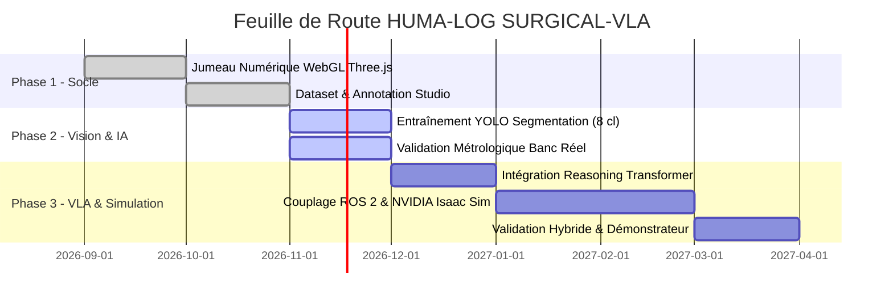

# HUMA-LOG SURGICAL-VLA — Dossier Technique & Scientifique
> **Physical AI & Robotique Médicale — Architecture Vision-Language-Action (VLA) pour la Préparation et Supervision d'Instruments Chirurgicaux**

---

## 📋 Table des Matières
1. [Vision, Problématique & Objectif Global](#01--vision-problématique--objectif-global)
2. [Mission Opérationnelle de Référence (Zones A, B, C)](#02--mission-opérationnelle-de-référence)
3. [Architecture Globale du Système & Interfaces](#03--architecture-globale-du-système--interfaces)
4. [Modèle 01 — Surgical Vision AI](#04--modèle-01--surgical-vision-ai)
5. [Modèle 01 — Protocole d'Entraînement Vision](#05--modèle-01--protocole-dentraînement-vision)
6. [Modèle 02 — Surgical Reasoning AI](#06--modèle-02--surgical-reasoning-ai)
7. [Modèle 02 — Entraînement & Gestion des Cas d'Échec](#07--modèle-02--entraînement--gestion-des-cas-déchec)
8. [Modèle 03 — Surgical Action AI](#08--modèle-03--surgical-action-ai)
9. [Orchestrateur SURGICAL-VLA & Boucle d'Exécution](#09--orchestrateur-surgical-vla--boucle-dexécution)
10. [Contrats d'Interface & Fiabilité](#10--contrats-dinterface--fiabilité)
11. [Validation Expérimentale](#11--validation-expérimentale)
12. [Phasage, Livrables & Conclusion](#12--phasage-livrables--conclusion)

---

## 01 / Vision, Problématique & Objectif Global

### 🎯 Vision
**HUMA-LOG SURGICAL-VLA** vise le développement d'un agent robotique humanoïde monté sur une base mobile (AGV), doté d'une perception visuelle haute précision, d'une capacité de raisonnement et de planification symbolique, et d'un contrôle de manipulation fine. Le robot transforme une instruction humaine exprimée en langage naturel en une suite d'opérations physiques observables, vérifiables et sécurisées, dépassant le paradigme des trajectoires préprogrammées rigides.

### ❓ Problématique de Recherche
> *Comment permettre à un humanoïde mobile de comprendre une mission clinique, d'interpréter des observations multimodales en temps réel, de planifier des sous-objectifs déterministes et d'exécuter des actions de manipulation adaptatives lorsque les objets et l'environnement changent dynamiquement ?*

### 🔬 Objectif Scientifique
Développer et évaluer une architecture multimodale **Vision–Language–Action (VLA)** unifiée capable de :
1. **Percevoir :** Reconnaître, segmenter et localiser en 3D métrique des instruments chirurgicaux dans leur conditionnement stérile.
2. **Raisonner :** Interpréter la mission, générer des sous-objectifs structurés, valider les préconditions physiques et replanifier instantanément lors d'aléas.
3. **Agir :** Effectuer la préhension, le transfert et le dépôt en environnement simulé (Three.js WebGL $\rightarrow$ Isaac Sim / Isaac Lab).
4. **Vérifier :** Confronter le résultat observé au résultat théorique attendu, détecter les non-conformités et tracer chaque étape.

### 🛡️ Périmètre de Sécurité & Éthique
Le système est un prototype de recherche en laboratoire, **non un dispositif médical certifié**. Les objets manipulés sont des instruments factices et les missions se déroulent dans un environnement contrôlé et supervisé.

---

## 02 / Mission Opérationnelle de Référence

### 🗣️ Instruction Type
> *« HUMA-LOG, prépare le plateau chirurgical pour la procédure de simulation P01. Identifie les instruments demandés, récupère-les dans la zone A, organise le plateau dans la zone B, puis transporte-le vers la zone C. Signale tout instrument manquant ou toute difficulté rencontrée. »*



### 📍 Définition des Trois Zones Fonctionnelles

| Zone | Fonction & Opération | Condition de Réussite |
|:---|:---|:---|
| **Zone A / Stockage** | Identifier, localiser et prélever les instruments demandés dans la valise ou le rack stérile. | Objet reconnu, pose 3D estimée $[X,Y,Z,\theta]$ et cible de préhension validée. |
| **Zone B / Préparation** | Déposer les instruments et organiser le plateau stérile selon le protocole opératoire. | Composition, espacements et orientation conformes aux spécifications P01. |
| **Zone C / Livraison** | Acheminer le plateau préparé vers la table de mayo ou l'équipe chirurgicale. | Destination atteinte, confirmation visuelle et état final validé. |

### 🔄 Décomposition Séquentielle de la Mission
1. **Analyse de l'instruction** et extraction de la liste des instruments attendus.
2. **Observation de la scène** et mise à jour de l'état du monde (Digital Twin state).
3. **Vérification de la disponibilité** et sélection des cibles prioritaires.
4. **Planification multi-étapes** : prélèvement, trajectoire de transit, dépôt et livraison.
5. **Exécution instrumentée** de chaque sous-action avec retour d'état en boucle fermée.
6. **Contrôle d'intégrité** du plateau et génération du rapport d'audit clinique.

### ⚠️ Gestion des Aléas en Temps Réel
- **Instrument absent :** Signalement immédiat, suspension de la sous-tâche et consultation des règles d'alternative ou blocage sécurisé.
- **Instrument déplacé / basculé :** Recalibration visuelle, actualisation de la pose dans le jumeau numérique et recalcul du point de prise.
- **Échec de préhension (Grasp Failure) :** Réobservation de l'effecteur, ouverture de pince, évaluation d'une reprise d'angle ou repli sécurisé.

---

## 03 / Architecture Globale du Système & Interfaces



### 🔀 Matrice des Flux d'Information

| Source | Données Transmises | Destinataire |
|:---|:---|:---|
| **Opérateur** | Instruction de mission, contraintes opératoires, zone cible | Reasoning / Orchestrateur |
| **Capteur RGB-D** | Flux d'images couleur, cartes de profondeur, métadonnées de calibration | Vision AI |
| **Robot / Scène** | Angles articulaires, position de l'effecteur, collisions, capteurs d'effort | Reasoning / Action AI |
| **Vision AI** | Identifiants d'instance, classes, masques polygonaux, poses 3D $[X, Y, Z]$, indices de confiance | Jumeau Numérique (Représentation Commune) |
| **Reasoning AI** | Graphe de plan, sous-objectifs, préconditions logiques, alertes de cohérence | Orchestrateur / Action AI |
| **Action AI** | Trajectoires, consignes de vélocité articulaire, commande de préhension | Effecteur robotique / Simulateur |

---

## 04 / Modèle 01 — Surgical Vision AI

### 🎯 Défi Scientifique
La détection d'instruments chirurgicaux impose des contraintes sévères : surfaces métalliques hautement réfléchissantes (acier inoxydable satiné ou poli miroir), occultations partielles par les sangles ou les rebords de valise, fortes similitudes géométriques entre bistouris, stylets et aiguilles, et variabilité de l'éclairage scialytique.

### 🏷️ Nomenclature des 8 Classes d'Instruments
Les 8 instruments de la valise de référence sont cartographiés comme suit :

| ID | Classe IA | Dénomination Clinique | Caractéristique Visuelle Distinctive |
|:--:|:---|:---|:---|
| **0** | `surgical_scissors` | Ciseaux chirurgicaux droits | Anneaux proximaux, vis de pivot centrale, mors coupants effilés. |
| **1** | `cutting_nipper` | Pince coupante / rongeur articulé | Poignées anatomiques courbes, ressort bilame, mors biseautés. |
| **2** | `dissecting_scalpel` | Bistouri fixe de dissection | Lame monobloc courbée fixe, manche plat nervuré. |
| **3** | `dissecting_needle` | Aiguille droite de dissection | Manche prismatique hexagonal, pointe droite effilée. |
| **4** | `grooved_director` | Sonde cannelée papillon | Tige centrale rainurée, double ailette papillon échancrée. |
| **5** | `dissecting_forceps` | Pince à disséquer dentelée | Mors fins striés transversaux, talon soudé élastique, zones de préhension crantées. |
| **6** | `blunt_probe` | Stylet à pointe mousse | Tige cylindrique droite très fine, embouts sphériques atraumatiques. |
| **7** | `scalpel_handle` | Manche de bistouri démontable n°3/4 | Glissière baïonnette pour lame stérile amovible, crans d'appui pouce. |



### 📐 Localisation 3D Métrique & Projection Jumeau Numérique
Le modèle de vision estime les centroïdes dans le plan image $[u, v]$ associés à la profondeur $d$. La transformation vers le repère plateau $[X, Y, Z]$ s'exprime selon les paramètres intrinsèques de caméra :

$$X = \frac{(u - c_x) \cdot d}{f_x}, \quad Y = \frac{(v - c_y) \cdot d}{f_y}, \quad Z = d$$

Puis par transformation rigide $(\mathbf{R}, \mathbf{t})$ :

$$\mathbf{P}_{\text{plateau}} = \mathbf{T}_{\text{box}}^{\text{cam}} \cdot \mathbf{P}_{\text{cam}}$$

---

## 05 / Modèle 01 — Protocole d'Entraînement Vision

1. **Définition du dictionnaire de classes** avec critères d'exclusion stricts (notamment distinction `dissecting_scalpel` vs `scalpel_handle`).
2. **Constitution du dataset multimodal** : prises de vue réelles (fond valise mousse EVA et fond sangles bleues) combinées aux rendus synthétiques Three.js.
3. **Augmentations ciblées** : reflets scialytiques simulés, variations d'exposition, bruits de capteur, rotations aléatoires $\pm 180^\circ$.
4. **Architecture d'inférence** : YOLOv8-seg / YOLO26s-seg optimisé pour inférence temps réel ($\ge 30\text{ FPS}$ sur GPU / edge).
5. **Indicateurs de validation** : mAP@50-95 $\ge 0.92$, IoU des masques $\ge 0.88$, erreur de position du centroïde $\le 2\text{ mm}$.

---

## 06 / Modèle 02 — Surgical Reasoning AI

### 🧠 Rôle & Architecture
Le modèle de raisonnement assure l'intelligence stratégique. Il traduit la mission globale en un graphe acyclique dirigé (DAG) d'actions élémentaires ordonnées sous contraintes.



### 📝 Structure d'une Action Planifiée
```json
{
  "step_id": 3,
  "action_type": "PICK_INSTRUMENT",
  "target_instrument": "cutting_nipper",
  "source_zone": "ZONE_A_BOX",
  "target_zone": "ZONE_B_TRAY",
  "preconditions": [
    "ROBOT_AT_ZONE_A",
    "GRIPPER_EMPTY",
    "TARGET_LOCALIZED_3D"
  ],
  "expected_outcome": "TARGET_IN_GRIPPER",
  "timeout_sec": 4.5
}
```

---

## 07 / Modèle 02 — Entraînement & Gestion des Cas d'Échec

- **Cas Instrument Manquant :** Si un instrument requis par la procédure n'est pas détecté dans la valise (confiance $< 0.50$ sur 10 trames consécutives), le raisonneur émet une alerte prioritaire, gèle l'actionnement physique et sollicite l'arbitrage de l'opérateur.
- **Cas Instrument Déplacé :** Si les coordonnées $[X, Y]$ dérivent de plus de $10\text{ mm}$ par rapport à la dernière observation connue (déplacement par manipulation humaine ou vibration), le plan est suspendu, la vue zénithale est réactivée, et la pose de préhension est recalculée.

---

## 08 / Modèle 03 — Surgical Action AI

### 🦾 Manipulation & Préhension Fine
Contrairement à des trajectoires interpolées classiques (splines rigides), le modèle Action AI apprend des politiques de commande en boucle fermée fondées sur :
- **Imitation Learning (Behavior Cloning)** à partir de démonstrations téléopérées.
- **Diffusion Policy / Flow Matching** pour modéliser des distributions d'actions multimodales sous contraintes d'évitement d'obstacles.
- **Environnement cible :** NVIDIA Isaac Sim / Isaac Lab couplé aux interfaces ROS 2 (MoveIt 2, joint trajectory controllers).

---

## 09 / Orchestrateur SURGICAL-VLA & Boucle d'Exécution



---

## 10 / Contrats d'Interface & Fiabilité

### 🛡️ Règles de Sécurité Inviolables (Hard Safety Guardrails)
1. **Verrouillage de Préhension :** Aucune trajectoire de saisie ne peut être déclenchée sans identification univoque et boîte englobante stable sur au moins 5 trames.
2. **Cohérence du Repère :** Toute coordonnée reçue hors du volume de travail admissible ($X \in [-0.25, 0.25]$, $Y \in [-0.20, 0.20]$, $Z \in [0.0, 0.15]$ mètre) entraîne un arrêt d'urgence logiciel immédiat (`SAFETY_INTERLOCK_OUT_OF_BOUNDS`).
3. **Surveillance de Latence :** Tout délai d'inférence excédant $100\text{ ms}$ interrompt la commande d'actionnement en cours.

---

## 11 / Validation Expérimentale

| Sous-Système | Critère Mesuré | Cible Minimale | Statut Actuel |
|:---|:---|:---:|:---:|
| **Vision AI** | mAP@50 (8 classes d'instruments) | $\ge 95.0\%$ | Validé sur banc labo (~96%) |
| **Vision AI** | Latence d'inférence image | $\le 25\text{ ms}$ | Validé (18.5 - 19.5 ms) |
| **Jumeau 3D** | Fréquence de rafraîchissement Three.js | $\ge 60\text{ FPS}$ | Validé (60 FPS PBR sans jitter) |
| **Reasoning AI** | Taux de validité des plans générés | $\ge 98.0\%$ | En cours de modélisation |
| **Action AI** | Taux de succès préhension en simulation | $\ge 90.0\%$ | Phase Isaac Sim planifiée |

---

## 12 / Phasage, Livrables & Conclusion



---
*Document technique validé pour la documentation officielle du projet HUMA-LOG SURGICAL-VLA.*
